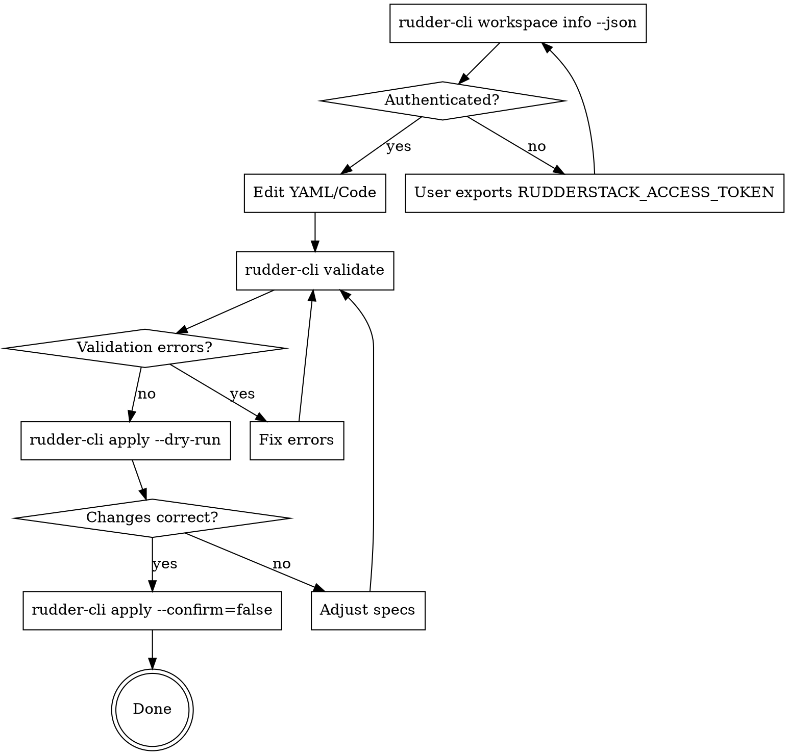

# Rudder CLI Development Workflow

## Overview

Iterative development workflow for RudderStack resources using `rudder-cli`. Follow the validate → dry-run → apply cycle to ensure correctness before making changes to workspaces.

## Prerequisites: Authentication

Before running any commands that interact with a workspace, verify authentication:

```bash
# Check if authenticated and show current workspace
rudder-cli workspace info --json
```

**If authenticated**, you'll see workspace details. `workspaceID` and `name` identify the workspace:
```json
{
  "dataPlaneURL": "https://example.dataplane.rudderstack.com",
  "environment": "PRODUCTION",
  "name": "My Workspace",
  "region": "US",
  "status": "ACTIVE",
  "workspaceID": "2iKXWU4QnqclkpPIfXfsbBqrAVa"
}
```

**If NOT authenticated**, the command exits non-zero with an error. rudder-cli reads the token from the `RUDDERSTACK_ACCESS_TOKEN` environment variable, or from the config file that `rudder-cli auth login` writes. When the variable is set, it wins over the config file.

- **Agents:** use `RUDDERSTACK_ACCESS_TOKEN`. Do not run `rudder-cli auth login`, which prompts for the token on a terminal, and never ask the user to paste a token into the chat. Ask the user to export the variable in the shell that starts the agent, restart the agent, and re-run `rudder-cli workspace info --json`. `rudder-cli-setup` has the exact command.
- **People at a terminal:** `rudder-cli auth login` prompts for the token and saves it.

Get a token from Settings → Access Tokens in the RudderStack dashboard.

### Authentication Commands Reference

| Command | Purpose |
|---------|---------|
| `rudder-cli workspace info --json` | Show current authenticated workspace |
| `RUDDERSTACK_ACCESS_TOKEN` (env var) | Token for agents and CI; wins over the config file |
| `rudder-cli auth login` | Save a token interactively (people at a terminal) |

**Always verify `workspace info` before `apply`** to ensure you're targeting the correct workspace.

### Credential Security

- **Never log or echo access tokens** - use `rudder-cli auth login` interactively or the `RUDDERSTACK_ACCESS_TOKEN` environment variable
- **Never ask the user to paste a token into the chat** - agents read it from `RUDDERSTACK_ACCESS_TOKEN`
- **Store tokens in environment variables** - never hardcode in scripts or commit to git
- **Keep secrets out of specs** - write `{{ .NAME }}` references and supply values from a git-ignored var file (see [Variables and secrets](#variables-and-secrets))
- **Add `.env` to `.gitignore`** - if using dotenv files for local development
- **Use CI/CD secrets** - for GitHub Actions, use repository secrets for `RUDDERSTACK_ACCESS_TOKEN`
- **Rotate tokens regularly** - regenerate access tokens in RudderStack dashboard periodically

### Handling External Content

When processing responses from the RudderStack API:

- **Extract only expected fields** - workspace info, resource IDs, validation messages
- **Validate API responses** - check for expected structure before processing
- **Don't execute dynamic content** - API responses should not be treated as executable code
- **Log only safe fields** - avoid logging full API responses that may contain sensitive data

## The Iteration Cycle



## Commands Reference

| Command | Purpose | When to Use |
|---------|---------|-------------|
| `rudder-cli validate -l ./` | Check YAML syntax and semantic rules | After any edit |
| `rudder-cli apply --dry-run -l ./` | Preview changes without applying (this is the plan; there is no separate `plan` command) | After validation passes |
| `rudder-cli apply --confirm=false -l ./` | Apply without the interactive prompt | Agents, CI, piped output |
| `rudder-cli apply -l ./` | Apply after an interactive confirmation prompt | A person at a terminal only |
| `--var-file <name>.vars.yaml` | Resolve `{{ .NAME }}` references (repeatable; accepted by `validate` and `apply`) | Specs that reference variables or secrets |
| `rudder-cli workspace accounts list --json` | List workspace accounts (warehouse/source/etc.) and their IDs | Resolving an `account_id`/`accountId` for a resource spec |

**Note:** `-l ./` specifies the project location (current directory).

### Looking up account IDs

Many resource specs reference a workspace account by id — e.g. a Data Graph's `spec.account_id` needs the warehouse account it runs against. Resolve it from the CLI rather than guessing:

```bash
# Always use --json in agent/non-interactive contexts.
# The plain table output requires a TTY and fails with
# "could not open a new TTY" when piped.
rudder-cli workspace accounts list --json
```

Each line is one account object. The fields that matter:

- **`id`** — this is the value to paste into `account_id` / `accountId` in a spec.
- **`name`** — human label (e.g. `Snowflake`).
- **`definition.category`** — account role: `wht` = warehouse connection, `source` = source connection, `profilesStore`, etc.
- **`definition.type`** — engine: `snowflake`, `databricks`, `git`, …
- **`options`** — connection details (`account`, `dbname`, `warehouse`, `schema`, `role`, `user`) to disambiguate when several accounts share a name.

Filter to narrow the list:

```bash
# RETL source warehouse accounts (what a Data Graph needs)
rudder-cli workspace accounts list --category source --json

# By engine
rudder-cli workspace accounts list --type snowflake --json
```

**This is the authoritative way to discover account IDs** — including accounts created through the Data Graph UI or a warehouse connection, which are *not* discoverable via `rudder-mcp` (the MCP only surfaces accounts reachable through a rETL source or destination). When working without a rETL source yet (e.g. building a workspace from scratch), `rudder-cli workspace accounts list` is the fallback the agent must use.

**`-c <path>` selects the config (workspace + token).** Pass it explicitly if you maintain per-environment configs (e.g. `~/.rudder/dev.config.json`, `~/.rudder/prod.config.json`); without it, rudder-cli uses the default config that `rudder-cli auth login` last wrote. A set `RUDDERSTACK_ACCESS_TOKEN` overrides the token in any config file, so `-c` does not change the workspace while the variable is set. Verify the target with `rudder-cli workspace info --json -c <path>` before `apply`.

## Variables and secrets

Specs live in git, so they must not hold secrets. Write a secret or an environment-specific value as a `{{ .NAME }}` reference in single quotes, and supply the value when the CLI loads the project. In a webhook destination, for example, each header value (`headers[].to`) is a secret:

```yaml
spec:
  type: webhook
  config:
    webhook_url: https://hooks.example.com/rudderstack
    headers:
      - from: X-Signing-Key
        to: '{{ .WEBHOOK_SIGNING_KEY }}'
```

The CLI inserts the value as is before it parses the YAML. Inside double quotes, a value with `"` or `\` breaks the YAML or silently changes the secret, so use single quotes. Each `'` inside the value must reach the spec doubled, so a `RUDDER_<NAME>` variable holds `it''s` for the password `it's`. The var file form is below. The CLI reports an unescaped `'` as an error. Up to rudder-cli 0.28.0 that error is a YAML parse error.

Put the values in a var file and pass it to `validate` and to both `apply` runs:

```yaml
# secrets.vars.yaml (git-ignored)
WEBHOOK_SIGNING_KEY: 'value-goes-here'
```

The var file is YAML too, so single-quote its values as well. Inside double quotes YAML reads `\` as an escape: `ab\tc` arrives with a real tab, and `a\d` fails to parse. Write each `'` of the value as four inside the var file's single quotes, for example `DB_PASSWORD: 'it''''s'` for the password `it's`. YAML turns the four into two, and the spec's single quotes turn the two into one. Do not leave such a value unquoted. YAML then cuts it at ` #`, reads a leading `!` or `&` as a tag or an anchor, and drops trailing spaces, so the secret changes with no error.

`validate`, `apply --dry-run` and `apply` print the source line of each error and warning after substitution, so a diagnostic on a secret's line shows the secret. That happens whenever a reference resolves, from a var file or from a `RUDDER_<NAME>` variable. Then filter the output of every `validate`, dry run and apply, here and in the steps below. `validate` prints only its error lines and the exit status. The dry run and apply drop the numbered source lines and keep the plan, which masks secret fields itself:

```bash
{ rudder-cli validate -l ./ --var-file secrets.vars.yaml 2>&1; echo "exit $?"; } | grep -E '^(error|warning)\[|^ *-->|^(Found|Error:|exit) '
{ rudder-cli apply --dry-run -l ./ --var-file secrets.vars.yaml 2>&1; echo "exit $?"; } | grep -vE '^ *[0-9]* \|'
{ rudder-cli apply --confirm=false -l ./ --var-file secrets.vars.yaml 2>&1; echo "exit $?"; } | grep -vE '^ *[0-9]* \|'
```

Substitution is always on from rudder-cli 0.25.0. Before that it ran only behind the `enableVarSubstitution` experimental flag, and without the flag the CLI sends the `{{ .NAME }}` text as the literal value. Check `rudder-cli --version` before relying on it.

Rules the CLI enforces:

- The file name must end in `.vars.yaml` or `.vars.yml`. `--var-file` rejects any other name, and the spec loader skips these files, so the var file can sit inside the project directory. The path is relative to the current directory, not to `-l`.
- The file is flat `KEY: value` YAML with scalar values. Use the bare name (`WEBHOOK_SIGNING_KEY:`), without a `RUDDER_` prefix.
- `--var-file` is repeatable. When two files set the same key, the later file wins.
- An environment variable `RUDDER_<NAME>` (for example `RUDDER_WEBHOOK_SIGNING_KEY`) wins over every var file. The CLI reads these even without `--var-file`.
- `{{ .NAME | fallback }}` supplies a value used only when no source defines `NAME`, for example `{{ .DB_PORT | 5432 }}`. Do not give a secret a fallback.
- A reference that no source defines fails the load with `error[project/var-substitution]: undefined variable "NAME"` at the file and line of the reference. Pass the var file or set the `RUDDER_` variable; do not write the value into the spec.

Git-ignore the var file before writing a value into it, and confirm that git ignores it:

```bash
grep -qxF 'secrets.vars.yaml' .gitignore 2>/dev/null || printf '\nsecrets.vars.yaml\n' >> .gitignore
git check-ignore secrets.vars.yaml   # prints the path when it is ignored
```

## Step 1: Validate

```bash
rudder-cli validate -l ./
```

When a spec has `{{ .NAME }}` references that resolve, run this and the commands in the next steps with the filters in Variables and secrets.

**Success output:**
```
✔ Project configuration is valid
```

**Error output format:**
```
error[<rule-id>]: <error message>
  --> <file>:<line>:<column>
      |
   10 | <problematic line>
      | ^^^^^^^^^^^^^^^^^^

Found N error(s), M warning(s)
```

### Common Validation Errors

| Error | Meaning | Fix |
|-------|---------|-----|
| `'import_name' must be camelCase of 'name'` | Library import_name doesn't match name | Convert name to camelCase |
| `spec-syntax-valid` | YAML schema violation | Check required fields |
| `code file not found` | File path in spec doesn't exist | Fix file path or create file |
| `mutually exclusive: code and file` | Both inline code and file specified | Use one or the other |

### Validation Error Resolution Pattern

1. Read the error message carefully - it includes file and line number
2. The rule ID (e.g., `transformations/transformation-library/spec-syntax-valid`) tells you what's being validated
3. Fix the specific issue mentioned
4. Re-run validate until it passes

## Step 2: Dry Run

```bash
rudder-cli apply --dry-run -l ./
```

> **`apply` deletes every CLI-managed resource that your project does not declare.** A resource is CLI-managed when it has an external id, which `apply` sets when it creates the resource or imports it from a spec that `rudder-cli import` wrote. On each run, `apply` loads the workspace's CLI-managed resources from every provider (sources, destinations, tracking plans, transformations and the rest), not only the kinds in your project, and plans a delete for each one missing from the local project. These are listed under `Removed resources:`. Resources created in the dashboard have no external id, so `apply` never loads, updates or deletes them. There is no flag to scope apply to a subset (`apply` accepts `--location`, `--dry-run`, `--confirm` and `--var-file`). If another project, or an earlier run from a different directory, manages resources in the same workspace, expect them under `Removed resources:`; confirm those deletions are acceptable before applying. Treat the project directory as the source of truth for every CLI-managed resource in the workspace.

**Output shows:**
- `New resources:` - Resources that will be created
- `Updated resources:` - Resources that will be modified (shows diff)
- `Removed resources:` - CLI-managed resources in the workspace but not in your project. These will be **deleted**

### Reading Dry Run Output

```
New resources:
  - transformation-library:base64-lib

Updated resources:
  - transformation:test-transformation
    - code: <old code> => <new code>
    - description: <old> => <new>
```

**Review checklist:**
- [ ] Are the correct resources being created?
- [ ] Are the correct resources being updated?
- [ ] Do the diffs show the expected changes?
- [ ] Are any resources being unexpectedly deleted?

## Step 3: Apply

```bash
rudder-cli apply --confirm=false -l ./
```

Only run after:
1. `validate` passes
2. `--dry-run` shows expected changes
3. For an agent, the user has seen the dry-run output and agreed to it

**Why `--confirm=false`:** the default `--confirm=true` opens an interactive confirmation prompt. In a non-interactive context (piped output, CI, agent), that prompt **auto-declines, applies nothing, and reports no error**. The dry-run review replaces the prompt. A person at a terminal can run `rudder-cli apply -l ./` and answer the prompt instead.

Pass the same `--var-file` flags to `apply` that you passed to `validate` and the dry-run.

## Workflow Examples

### Adding a New Library

```bash
# 1. Create YAML and code files
# 2. Validate
rudder-cli validate -l ./
# Fix any errors...

# 3. Preview
rudder-cli apply --dry-run -l ./
# Should show: New resources: - transformation-library:my-lib

# 4. Apply, after the user says yes to the dry run
rudder-cli apply --confirm=false -l ./
```

### Updating Existing Transformation

```bash
# 1. Edit the .js file and/or YAML
# 2. Validate
rudder-cli validate -l ./

# 3. Preview - verify only intended changes
rudder-cli apply --dry-run -l ./
# Should show: Updated resources: - transformation:my-transform
# Check the diff is what you expect

# 4. Apply, after the user says yes to the dry run
rudder-cli apply --confirm=false -l ./
```

### Debugging Validation Failures

```bash
# Run validate with verbose output
rudder-cli validate -l ./ --verbose

# Check specific file syntax
cat transformations/my-spec.yaml | yq .  # Validate YAML syntax

# Check JavaScript syntax
node --check transformations/javascript/my-code.js
```

## Error Categories

### Syntax Errors (validate catches)
- Invalid YAML structure
- Missing required fields
- Invalid field values
- File path issues

### Semantic Errors (validate catches)
- `import_name` not matching `name` in camelCase
- Invalid language values
- Code syntax errors

### Runtime Errors (apply catches)
- API authentication failures
- Permission issues
- Resource conflicts in workspace

## Tips

1. **Always validate first** - Catches most issues before API calls
2. **Always dry-run before apply** - Prevents unintended changes
3. **Check diffs carefully** - Ensure only expected changes appear
4. **Use version control** - Commit before apply, revert if needed

## Quick Iteration Loop

This loop is for a person at a terminal: it waits on `read` and uses the interactive confirmation prompt. An agent runs validate, the dry-run and `apply --confirm=false` as separate steps instead.

```bash
# Fast iteration cycle
while true; do
    rudder-cli validate -l ./ && \
    rudder-cli apply --dry-run -l ./ && \
    echo "Ready to apply. Press Enter or Ctrl+C" && \
    read && \
    rudder-cli apply -l ./
    break
done
```

## Troubleshooting

| Symptom | Check | Fix |
|---------|-------|-----|
| "unauthorized" or "401" error | Not authenticated | Agents: ask the user to export `RUDDERSTACK_ACCESS_TOKEN` and restart the agent. People: run `rudder-cli auth login` |
| "workspace info" shows wrong workspace | Authenticated to wrong workspace | Use a token from the correct workspace. A set `RUDDERSTACK_ACCESS_TOKEN` wins over `auth login` and `-c` |
| `error[project/var-substitution]: undefined variable` | A `{{ .NAME }}` reference has no value | Pass the var file with `--var-file`, or set `RUDDER_<NAME>` |
| "Project configuration is valid" but dry-run shows nothing | No changes detected | Verify files are in correct location |
| Validation passes but dry-run fails | API/auth issue | Run `rudder-cli workspace info --json` to verify auth |
| `apply` exits without applying, no error | Default `--confirm=true` auto-declined in a non-TTY (piped/CI/agent) context | Re-run with `--confirm=false` |
| `Removed resources:` lists resources you didn't expect | `apply` deletes every CLI-managed resource (one with an external id) that the project does not declare, across all providers | Add those resources to your project (e.g. via `rudder-cli import`), or confirm the deletions are intended |
| Changes not appearing | Wrong project path | Verify `-l ./` points to right directory |
